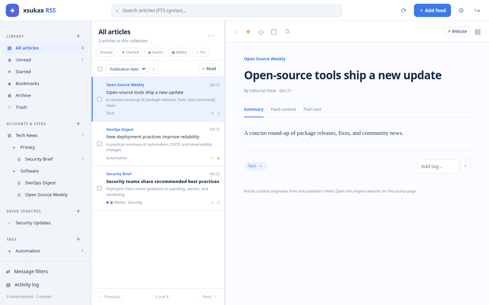
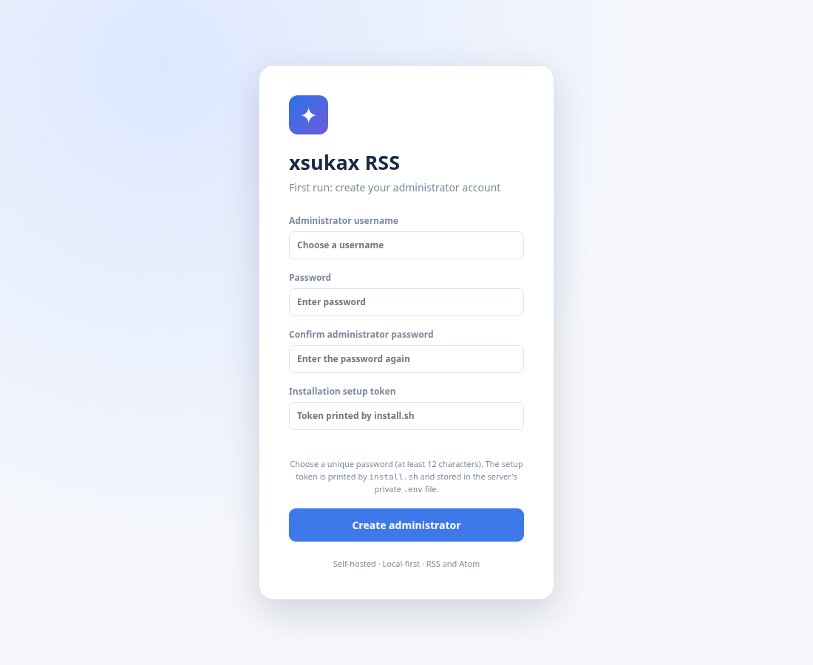

# xsukax RSS Aggregator

A **self-hosted, single-administrator RSS and Atom reader** inspired by Mozilla Thunderbird's feed reader. It uses a FastAPI backend, SQLite FTS5 search, background feed polling, and a lightweight HTML/CSS/JavaScript interface. Designed for a small Debian 13 VPS and Cloudflare Tunnel.

> **Project status: functional foundation / pre-release 0.1.1.** The attached specification describes a substantially larger product. This repository implements its major core workflows but is **not** a completed implementation of every requested capability. Refer to [FEATURE_MATRIX.md](docs/FEATURE_MATRIX.md) for exact coverage, omissions, and limitations. It has not undergone an independent security audit or verified production Docker build in the creation environment.



The first-run administrator setup is performed in the browser (captured from the actual application interface, with no production credentials):



## Implemented core capabilities

- Local RSS/Atom accounts, nested folders, direct subscriptions, bulk OPML import/export, and website feed discovery.
- RSS 2.0, RDF/RSS 1.0, and Atom 1.0 parsing; article metadata, category tagging, syndicated HTML, enclosure links, and published/updated timestamps.
- Scheduled background updates with per-feed interval, account pauses, manual refresh, ETag and Last-Modified conditional requests, 304 handling, bounded concurrency, and failure backoff.
- Article read/unread, stars, bookmarks, archival, Trash/restoration, bulk actions, tags, automatic feed-category tags, and original-site links.
- Search with SQLite FTS5, Boolean and phrase syntax, saved-search folders, server-side Quick Filters and pagination.
- Rule-based message filters with nested AND/OR/NOT logic, regex with timeouts, prioritization, tag actions, account/feed scopes, and manual execution.
- Login with Argon2 password hashing, random hashed database sessions, CSRF checks, installation-token-based first-run setup, and feed URL SSRF protection.
- Browser UI: three panes, collapsible mobile sidebar, basic drag/drop feed organization, preview modes, light/dark themes, keyboard shortcuts, notifications from rules, diagnostics, article CSV export, printable article view.
- Local SQLite data volume, simple schema-version tracking, backup shell script, container restart persistence, GPL-3.0 license.

## Quick start: Debian 13 / Debian 12 / supported Ubuntu

Extract the release ZIP and enter the project directory:

```bash
unzip xsukax-rss-aggregator.zip
cd xsukax-rss-aggregator
sudo ./install.sh
```

The installer checks for Docker and the Compose plugin, installs them from Docker's official APT repository when absent, generates `.env` secrets, prepares the bind-mounted `data/` directory, and runs `docker compose up -d --build`.

The installer **waits for the container to become healthy** and prints an error with recent logs if startup fails. It prints a **first-run setup token**. Open **http://127.0.0.1:8090** in a browser on the VPS (or use an SSH port forward from your desktop). On the first visit you must choose **your own administrator username, password (12+ characters), and matching password confirmation**, then enter the first-run token. No production administrator password is preconfigured. The password is stored only as an Argon2id hash. The token remains in your private `.env`; after an administrator exists, the first-run endpoint cannot be used again. Do not publish the `.env` or `data/` directory.

The installer binds the service to `127.0.0.1` only. It does not open a public firewall port. Override the external listening port before the initial install by using `sudo APP_PORT=9123 ./install.sh`. If already installed, edit `APP_PORT` in `.env` and restart the container.

### Fixing a previously crashing installation

If Docker repeatedly restarts and its logs say `Form data requires "python-multipart" to be installed`, use this updated source tree (`requirements.txt` includes `python-multipart`) and rebuild the image:

```bash
cd ~/xsukax-rss-aggregator
sudo docker compose up -d --build
sudo docker compose ps -a
curl -fsS http://127.0.0.1:8090/healthz
```

**Do not install `python-multipart` on the Debian host or inside a restarting container**; rebuild the image from the corrected requirements. Copy the new project files over the old ones but **preserve your existing `.env` and `data/`**. Re-running `sudo ./install.sh` with the updated source is also safe for those two resources: the installer preserves `.env` and the persistent database. To find the first-run setup token on an existing server, run `sudo grep '^SETUP_TOKEN=' .env` locally (keep its output private). Your administrator password is chosen only in the browser; the installer does not ask for or store it in `.env`.

### GitHub release safety

The `.gitignore` excludes `.env`, databases, backups, and Python caches. Never add runtime state or real user feeds to this public repository. The automated tests use disposable test credentials only. Production installations must be configured through first-run web setup.

### Cloudflare Tunnel

If `cloudflared` runs on the **same VPS host**, create a public hostname pointing to the service origin:

```text
Service type: HTTP
Origin URL: http://localhost:8090
Public URL example: https://rss.example.com
```

Then set in `.env`:

```ini
PUBLIC_URL=https://rss.example.com
```

And restart:

```bash
sudo docker compose up -d --force-recreate
```

This enables the browser session cookie's `Secure` flag. **When PUBLIC_URL uses HTTPS, sign in through the HTTPS hostname rather than the plain-HTTP local address**; secure session cookies are not sent over plain HTTP. Consider also placing the hostname behind Cloudflare Access.

Do not configure an HTTPS origin on `localhost:8090`; Cloudflare terminates public TLS and connects to this application locally using HTTP.

### Managing the container

```bash
sudo docker compose ps
sudo docker compose logs --tail=100 -f
sudo docker compose restart
sudo docker compose stop
sudo docker compose start
sudo docker compose up -d --build
```

Use a **single Uvicorn worker**. This application includes an in-process background scheduler; multiple Uvicorn processes would cause duplicated background workers. The Compose file sets `--workers 1`, `REFRESH_WORKERS=2`, and a 384 MB memory cap.

### Backup and restore

```bash
sudo ./backup.sh
```

The script creates a consistent SQLite online backup and a protected `backups/xsukax-rss-<timestamp>.tar.gz` archive containing the database and `.env` secrets. Store a copy off-server and protect it like a password database.

To restore, after backing up your current data:

```bash
sudo docker compose down
mkdir -p /tmp/xsukax-rss-restore
sudo tar -xzf backups/ARCHIVE-NAME.tar.gz -C /tmp/xsukax-rss-restore
sudo cp /tmp/xsukax-rss-restore/rss-*.sqlite3 data/rss.sqlite3
sudo chown 10001:10001 data/rss.sqlite3
sudo rm -f data/rss.sqlite3-wal data/rss.sqlite3-shm
sudo docker compose up -d
```

Replace `ARCHIVE-NAME.tar.gz` with the exact archive name. Restoring `.env` is optional; if you choose to restore its older credentials, copy it separately while the container is stopped and set mode 600. The app will not automatically restore deleted articles outside the database snapshot.

### Uninstall

```bash
sudo ./uninstall.sh
```

This removes/stops the Compose containers but deliberately **retains** `./data/`, `./backups/`, and `.env`. It does not uninstall Docker from the host or delete other containers.

## Browser usage

1. Sign in with the administrator credentials.
2. Select **Add feed** to subscribe using an RSS/Atom URL. For an ordinary website URL, click **Discover feeds** first.
3. Create folders with the plus sign beside **Accounts & Feeds**. Drag feeds onto folders within the same account.
4. Select a folder or feed to read its articles. Choose **Unread**, **Starred**, or other Smart Collections from the sidebar.
5. Mark, star, bookmark, archive, delete, or tag articles. Use the checkbox toolbar for bulk actions.
6. Search by entering SQLite FTS5 expressions into the top search box, e.g. `security`, `"open source"`, or `security OR privacy`.
7. Create filters from **Message filters**; for complex nested conditions, paste JSON in the advanced input fields.
8. Manage feed refresh intervals, pausing, and auto-categorization by selecting a feed and clicking `⋯`.
9. Import and export OPML through **Settings**. Access diagnostics through **Activity log**.

**Keyboard shortcuts:** `/` search, `r` refresh all, `j` next article, `k` previous article, `s` star selected article, `Esc` close dialogs. The basic shortcuts cannot yet be reassigned.

## Architecture

```text
Browser (HTML/CSS/JS)
  │ HTTPS via Cloudflare Tunnel (optional)
  ▼
localhost:8090 → Docker 8080
  ▼
FastAPI (single Uvicorn process)
  ├─ Auth, CSRF, account/feed/article/tag/filter APIs
  ├─ In-process timed scheduler (12 s polling loop)
  │    └─ ThreadPoolExecutor (2 by default; max 4)
  │          ├─ Safe public-IP-pinned HTTP(S) feed fetcher
  │          ├─ defusedxml RSS/Atom parser + bleach sanitizer
  │          ├─ ETag/304 + duplicate detection + auto-tagging
  │          └─ Filter execution and article indexing
  └─ SQLite /data/rss.sqlite3 (WAL + FTS5)
```

The server has no dependence on external RSS API services. It issues direct HTTP(S) requests to the feed publisher. Only standard public ports `80`, `443`, `8080`, and `8443` are accepted for outbound feeds. Private, link-local, loopback, multicast, and non-global addresses are blocked. Redirect destinations are independently checked. Remote images embedded in articles may load directly in a user's browser.

## Development without Docker

With Python 3.12 or newer:

```bash
python3 -m venv .venv
. .venv/bin/activate
pip install -r requirements.txt
export DATA_DIR="$(pwd)/data"
export APP_SECRET="$(python -c 'import secrets;print(secrets.token_hex(32))')"
export SETUP_TOKEN="$(python -c 'import secrets;print(secrets.token_urlsafe(24))')"
uvicorn app.main:app --host 127.0.0.1 --port 8090 --workers 1
```

The first-run setup screen requires the token generated above. The test suite uses deterministic RSS fixtures and does not need internet access:

```bash
PYTHONPATH=. pytest -q tests/
node --check app/static/app.js
```

Screenshots in `docs/preview-*.png` were captured from a live local instance of the app using neutral demo data. See [feature coverage](docs/FEATURE_MATRIX.md) and [security notes](docs/SECURITY.md).

## Source references

Thunderbird-inspired behaviors were cross-checked with Mozilla's [How to Subscribe to News Feeds and Blogs](https://support.mozilla.org/en-US/kb/how-subscribe-news-feeds-and-blogs) and Thunderbird's [RSS Feed Guide](https://blog.thunderbird.net/2022/05/thunderbird-rss-feeds-guide-favorite-content-to-the-inbox/). The installer follows the approach described by [Docker's official Debian instructions](https://docs.docker.com/engine/install/debian/).

The project is independently written, not a copy of Thunderbird's code. Thunderbird's email architecture and a browser-based local-first reader have meaningful differences. Read-state sync, original-website archiving, multi-user accounts, and IMAP forwarding remain outside this release.

## License

Licensed under **GNU GPL v3.0**. See [LICENSE](LICENSE) for the complete license text.
